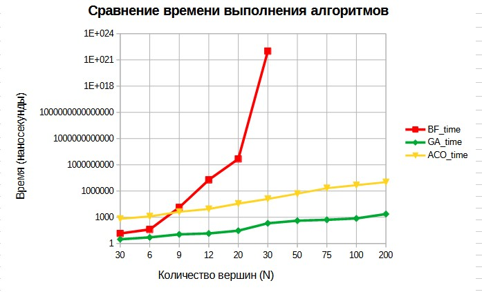
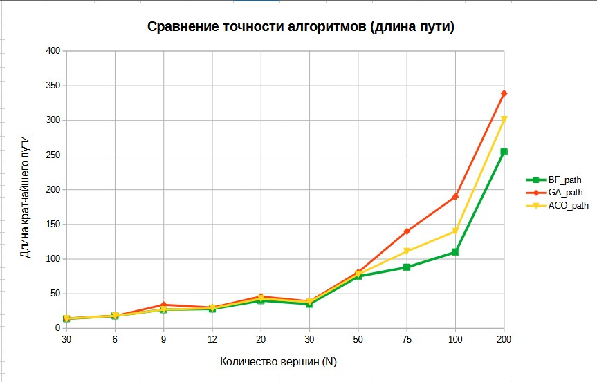

# Graphs-Algorithms-Research

> Теория графов в решении прикладных задач: от классических алгоритмов обхода до метаэвристической оптимизации.

Научно-исследовательский проект: реализация, бенчмаркинг и сравнительный анализ алгоритмов на взвешенных графах и трёх методов решения NP-полной задачи коммивояжёра (TSP).

- **Автор:** Матвеев Дмитрий Михайлович, студент 1 курса ИТМО (ФИТиП, ПМИ «Компьютерные технологии»)
- **Стек:** C++17, STL, OOP, `std::mt19937`
- **Статус:** базовая версия завершена; усовершенствованная версия (GraphLab) в разработке

---

## Алгоритмы

| Группа | Алгоритм | Сложность (время / память) |
|---|---|---|
| Обход | BFS (очередь, FIFO) | O(V+E) / O(V) |
| Обход | DFS (стек, LIFO) | O(V+E) / O(V) |
| Кратчайшие пути | Флойд–Уоршелл (динамическое программирование) | O(V³) / O(V²) |
| TSP | Brute Force (backtracking, эталон) | O(n!·n) / O(n!·n) |
| TSP | Greedy (выбор ближайшей вершины) | O(n²) / O(n) |
| TSP | ACO (муравьиный алгоритм, метаэвристика) | O(t_max·m·n²) / O(n²) |

**Архитектура:** решатели TSP наследуются от абстрактного базового класса `Solve` с виртуальным методом `solve_path()`; граф хранится матрицей смежности; вершина — структура `Node` с системой покраски (White/Gray/Black) и указателем `prev` для восстановления путей.

**Параметры ACO:** α=1.0, β=1.0, ρ=0.2, Q=100, m=n муравьёв, t_max=400 итераций, начальная концентрация феромонов 0.01.

## Ключевые результаты

Методика: случайные взвешенные графы от 3 до 200 вершин, 10 запусков на каждую точку, результаты усреднены.

| Метод | Точность | Время |
|---|---|---|
| Brute Force | 100% (эталон) | n=12: ~19 мс; при n>12 неприменим |
| Greedy | отклонение 20–30% от оптимума | n=200: ~1.3 мкс |
| ACO | отклонение 7–15% от оптимума | n=200: ~10 мс |

**Выводы:**
- ACO на **28% точнее** жадного алгоритма при n=200 и в **2158 раз быстрее** полного перебора при n=12;
- полный перебор неприменим уже при n>12, жадный алгоритм быстр, но застревает в локальных минимумах;
- ACO обеспечивает оптимальный баланс точности и производительности и масштабируется до сотен вершин.




## Структура репозитория
├── src/                            # Исходный код (C++17)
│   ├── algos_in_graphs.cpp         # BFS, DFS, Флойд–Уоршелл
│   └── bf_ga_aco.cpp               # Решатели TSP + бенчмарк
├── docs/                           # Документация
│   ├── research_paper_graphs.pdf   # Полный текст НИР (20 стр.)
│   ├── Code_project_Graphs.pdf     # Отчёт об архитектуре кода
│   ├── Graphs_presentation.pdf     # Презентация проекта
│   └── Code_project_Graphs.odt     # Редактируемый исходник отчёта
├── results/                        # Результаты эксперимента
│   ├── time_comparison.jpg         # График времени (лог-шкала)
│   ├── accuracy_comparison.jpg     # График точности
│   ├── benchmark_tables.xlsx       # Сводные таблицы бенчмарка
│   └── *.png                       # Скриншоты работы алгоритмов
└── README.md

## Сборка и запуск

Требования: компилятор с поддержкой C++17 (GCC 7+, Clang 5+, MSVC 2017+).

```bash
g++ -std=c++17 -O2 src/algos_in_graphs.cpp -o graph_algos
g++ -std=c++17 -O2 src/bf_ga_aco.cpp -o tsp_solver

./graph_algos   # демонстрация BFS, DFS, Флойд–Уоршелла на тестовом графе
./tsp_solver    # бенчмарк TSP: Brute Force vs Greedy vs ACO